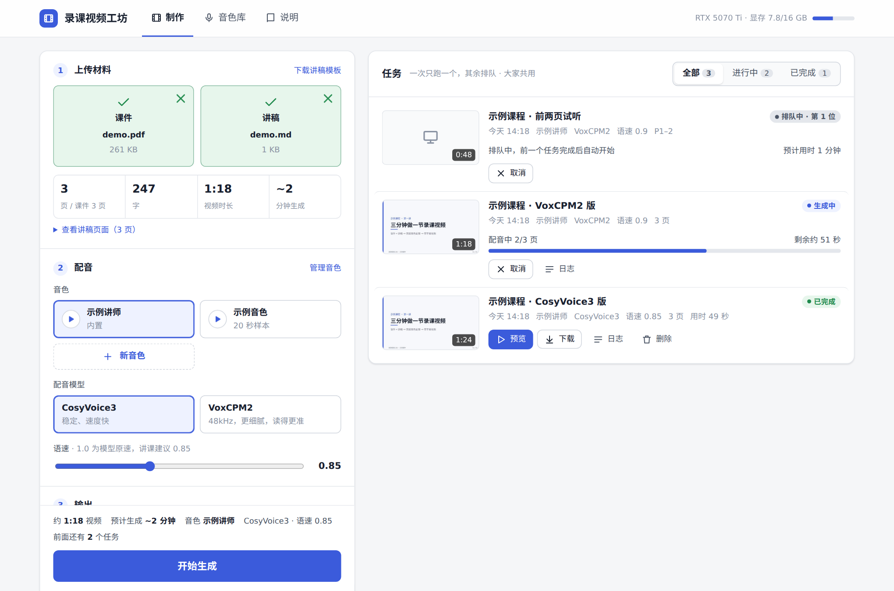
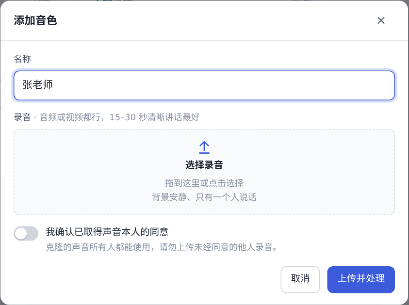
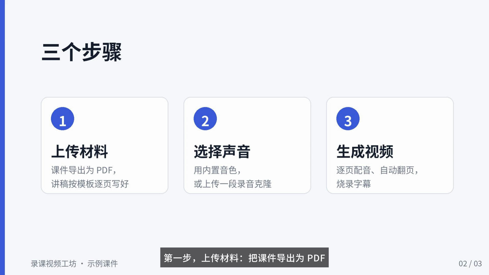

# 录课视频工坊 · Lecture Video Studio

把 **课件（PDF/PPTX）+ 讲稿** 变成 **用指定声音配音、带字幕的录课视频**。整套流程在自己的显卡上跑，不调用任何云端 API。

*Turn slides + a written script into a narrated, subtitled lecture video with a cloned voice — fully local, self-hosted web app for Chinese course production.*



## 能做什么

- **逐页配音、自动翻页**：每页课件配上对应的讲稿朗读，页面切换和配音严格对齐。
- **声音克隆**：上传一段 15–30 秒的清晰录音，就能用这个声音讲课。服务器会自动挑出完整的句子并识别出对应文字。
- **两个配音模型可选**：[CosyVoice3](https://github.com/FunAudioLLM/CosyVoice)（稳定、快）和 [VoxCPM2](https://github.com/OpenBMB/VoxCPM)（48kHz，更细腻），网页上一键切换，参数随模型变化。
- **字幕**：字幕直接取自讲稿，不靠识别，所以没有错字。长句按标点自动拆成短行，可以烧进画面，也可以做成能开关的软字幕，还会单独输出 .srt。
- **读音与口语化**：填写“原词 → 读法”，用同音字纠正多音字，或改成自己习惯的口语；数字、单位、日期默认按中文读；规则全组共用，每条可单独启用，多音字“调”读 tiáo 也是其中几条规则。只改配音、字幕保留讲稿原文；两种模型共用同一套处理，生成前能预览最终读法（改动处高亮，没用上的规则会提示），设置随任务保存并用于重试。
- **网页端，多人共用**：局域网里的同事打开浏览器就能用。任务排队，一次只占一张显卡，跑完就释放显存。
- **语音识别工具**：用 [Qwen3-ASR](https://github.com/QwenLM/Qwen3-ASR) 给真人录的课自动出字幕，带逐字时间戳。

| 添加音色 | 生成的视频（字幕烧进画面） |
|---|---|
|  |  |

## 实测（RTX 5070 Ti 16GB）

| | CosyVoice3 | VoxCPM2 |
|---|---|---|
| 45 分钟录课的生成用时 | 约 21 分钟 | 约为视频时长的一半，另加约 1 分钟加载模型 |
| 显存峰值 | 约 3–4GB | 约 6GB |
| 读错率（把配音转写回文字，和讲稿比对；3 页 404 字） | 0.25% | 0%（0.9 倍速） |
| 语速 | 模型内调节，讲课建议 0.85 | 合成后变速，讲课建议 0.9 |

## 安装

需要：Linux、NVIDIA 显卡（建议 ≥ 10GB 显存，驱动支持 CUDA 12.8）、[Miniconda](https://docs.conda.io/en/latest/miniconda.html)、git，以及下面这些系统包：

```bash
sudo apt install poppler-utils fonts-noto-cjk      # PDF 转图、字幕字体
sudo apt install libreoffice-impress               # 可选：直接上传 .pptx 时用
```

然后：

```bash
git clone https://github.com/Artifical0/lecture-video-studio.git
cd lecture-video-studio
./install.sh          # 国内网络用 ./install.sh --cn（清华 conda / 阿里云 pip 镜像）
./run.sh start        # 打开 http://服务器IP:8095 ，密码见 install.sh 的输出或 .env
```

`install.sh` 会在仓库目录里建三个 Python 环境，再从 ModelScope 下载四个模型，一共约 15GB：

| 环境 | 用途 |
|---|---|
| `envs/main` | CosyVoice3 + 网页，含 torch 2.7.1 (cu128) 和带 libass 的 ffmpeg |
| `envs/voxcpm` | VoxCPM2，建在主环境之上，共用 torch |
| `envs/asr` | Qwen3-ASR，同上 |

> 依赖版本冲突（qwen-asr 固定 transformers 4.57，VoxCPM2 需要 gradio 6 等），所以分成三个环境。用 `--system-site-packages` 共用主环境的 torch，不必重复下载。

开机自启：`crontab -e` 里加一行 `@reboot /path/to/lecture-video-studio/run.sh start`。

## 使用

### 网页

1. **上传材料**：课件建议在 PowerPoint/WPS 里另存为 PDF 再上传。讲稿按下面的格式写。网页会立即检查格式、页码，并估算视频时长。
2. **配音**：选一个音色（可以在“音色库”里添加），选模型和语速。
3. **读音与口语化**：在“共用读音规则”里勾选要用的规则（全组共用），只这一次用的写在“本次临时规则”里，点“检查读法”查看最终读法。
4. **输出**：可以只生成几页先试听；字幕选烧进画面、软字幕或只要 .srt。

### 读音与口语化

配音前依次处理：**读音规则（共用规则 + 本次临时规则）→ 数字和单位按中文读**。规则替换出的文字不会再被数字读法改动，所以规则总是优先；预览里两类改动用不同颜色标出，鼠标停上去能看到原文，每条共用规则旁显示它在本讲稿里用到几处。

#### 读音规则

规则分两种：

- **共用读音规则**：保存在服务器的数据目录（`pronunciation-rules.json`），全组共用。网页上每条规则可以单独勾选启用、修改读法或删除，也可以添加新规则。“调”读 tiáo 是内置的几条：`调 → 条`（CosyVoice 用拼音 tiáo），`强调`、`调度`、`对调` 保持原读，默认不启用，控制、电子类课程勾选即可，也可以加新的例外词。
- **本次临时规则**：只用于这次生成，格式同下。和共用规则写了同一个原词时，以临时规则为准。

提交任务时，当时启用的共用规则和临时规则一起随任务保存；之后修改共用规则，不影响已提交的任务和它们的重试。

临时规则每行一条，支持 `=>` 或 `→`，空行和 `#` 开头的注释会忽略，例如：

```text
调参 => 条参
我们 => 咱们
2026年 => 二零二六年
```

只修改送给配音模型的文字，字幕仍显示“调参”“我们”“2026年”。两种模型都可使用同音字或明确的汉字读法，直接输入拼音可能被模型当作英文朗读。具体音效仍由模型决定，请先生成少量页面试听。

规则对本次所选页面全部生效，区分大小写，同一位置优先匹配长词，一次替换，不再处理替换后的结果。要限定语境，填写完整词组或短句，避免对单个多音字一刀切。共用规则和临时规则各最多 100 条，原词不能重复；读法和原词相同表示保持原读（例如 `强调 => 强调`）。

预览会列出在所选页面一次都没用上的临时规则，通常是原词写错（区分大小写）或页码范围不对。

#### 数字和单位按中文读

默认打开（实测 VoxCPM2 直接读原文时会把 `12.5m/s` 读成“每秒二点五米”，打开后读对）。`2026年` 读作“二零二六年”，`3.7V` 读作“三点七V”，`5%` 读作“百分之五”，`-10℃` 读作“负十摄氏度”，`9:30` 读作“九点三十分”。两个模型用同一套规则（[WeTextProcessing](https://github.com/wenet-e2e/WeTextProcessing) 的中文文本正则化），读法一致。型号、编号这类按位读的数字（如 `2212` 电机、`COM3`）可能被读成整数，加一条规则写明读法即可（`2212 => 二二一二`），规则优先。

需要 `models/wetext-zh-tn/` 下的两个规则文件，`install.sh` 会从 PyPI 的 WeTextProcessing 包里取出；缺少时这一项在网页上不可选，不影响其他功能。

#### 命令行

命令行不读共用规则：把规则保存为 UTF-8 文本文件（格式同临时规则），加 `--pronunciation 读音规则.txt`；数字读法加 `--numbers`，“调”读 tiáo 可以写进规则文件，也可以加 `--tiao`。

### 讲稿格式

```markdown
# 第1讲｜课程名称

## P01｜封面                ← 页码 = 课件第几页，“｜”是全角竖线
### 口播正文                ← 朗读
同学们好，欢迎来到本课程的第一讲。
### 讲解提示（不朗读）        ← 其他小节都不读
封面停留即可。
### 过渡                    ← 朗读
先看一下今天的路线图。
```

完整示例见 [`examples/demo.md`](examples/demo.md)，配套课件是 [`examples/demo.pdf`](examples/demo.pdf)，模板见 [`web/template.md`](web/template.md)。

### 命令行

```bash
# 生成视频
envs/main/bin/python lvs/make_video.py --script examples/demo.md --slides examples/demo.pdf \
    --voice-wav 参考.wav --voice-text 参考.txt --out 示例 --out-dir output [--engine voxcpm] [--pages 1-2]

# 从一段录音提取音色样本（自动挑 12–28 秒完整句子，写出 prompt.wav / prompt.txt）
envs/asr/bin/python lvs/voice_prep.py 录音.mp4 my_voice/

# 给真人录课出字幕（可加 --burn 直接烧进视频）
envs/asr/bin/python lvs/transcribe.py 录课.mp4 --terms "专有名词,PX4"
```

## 配置

所有配置都在仓库根目录的 `.env` 里（模板：[`.env.example`](.env.example)）。常用项：

| 变量 | 说明 |
|---|---|
| `LVS_PASSWORD` | 网页访问密码（所有人共用） |
| `LVS_HOST` / `LVS_PORT` | 监听地址，默认 `0.0.0.0:8095`；只在本机用改成 `127.0.0.1` |
| `LVS_DATA` | 任务和音色数据目录，默认 `data/` |
| `LVS_BUILTIN_VOICE_*` | 可选的内置音色（名称、参考录音、对应文字） |
| `LVS_PY_*` / `LVS_*_MODEL` | 环境和模型位置，已经装好了的可以直接指过去 |

## 目录

```
lvs/            核心脚本（命令行和网页共用）
  make_video.py   讲稿 + 课件 → 配音 → 视频 + 字幕
  burn.py         字幕拆行、烧录（ASS，白字半透明底条）
  voice_prep.py   参考录音 → 音色样本
  transcribe.py   语音识别出字幕
  qasr.py script.py slides.py config.py
  pronunciation.py 读音处理（自定义规则、“调”、数字读法）与预览
  number_reading.py 数字和单位按中文读
web/            网页（FastAPI + 单页前端）
examples/       示例课件和讲稿
install.sh run.sh .env.example
```

## 开发验证

不加载模型、不需要显卡：`python -m pip install -r tests/requirements.txt`，然后 `python -m unittest discover -s tests -v`。测试覆盖规则匹配、API 校验、任务保存与重试、两个引擎的文字入参和字幕保留；真实发音需要在模型服务器上试听验收。

## 注意

- **声音克隆要取得本人同意。** 网页上传音色时必须勾选确认，但系统无法核实。请只用自己或已授权的声音，生成的内容也不要用于冒充他人。
- **网页只适合在局域网或内网使用。** 访问控制只有一个共享密码，没有 HTTPS，也没有分用户权限：所有人共用任务列表和音色库，都可以下载、删除。不要直接暴露到公网。
- PPTX 由 LibreOffice 转换，字体和版式可能和 PowerPoint 略有不同；动画不会保留，每页只显示最终画面。
- 目前只在 Ubuntu 22.04 + RTX 5070 Ti（16GB）上完整测试过。`install.sh` 按这台机器的实际安装步骤整理，还没有在全新机器上从头跑过；遇到问题欢迎提 issue。

## 致谢与协议

本项目代码以 [MIT](LICENSE) 协议开源。用到的模型和库各有协议，使用前请查看：

- [CosyVoice](https://github.com/FunAudioLLM/CosyVoice) / Fun-CosyVoice3-0.5B：代码 Apache-2.0，模型权重以模型主页为准
- [VoxCPM2](https://github.com/OpenBMB/VoxCPM)：Apache-2.0
- [Qwen3-ASR / Qwen3-ForcedAligner](https://github.com/QwenLM/Qwen3-ASR)：Apache-2.0
- [FFmpeg](https://ffmpeg.org/)、[libass](https://github.com/libass/libass)、[Poppler](https://poppler.freedesktop.org/)、[LibreOffice](https://www.libreoffice.org/)
